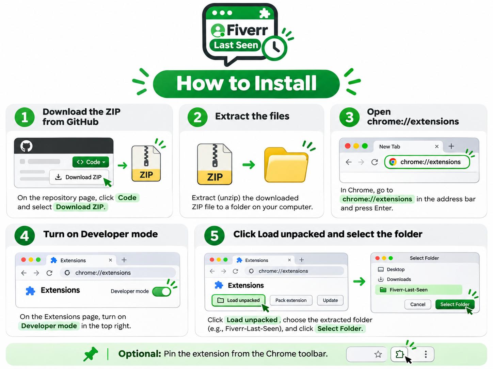
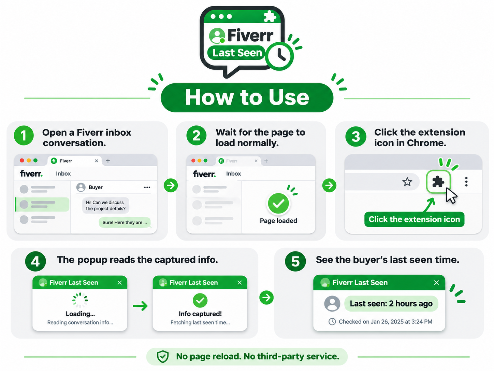

<div align="center">
  

  # Inbox Last Seen for Fiverr (Unofficial)

  **See a buyer’s available last-active time in a small, local Chrome toolbar popup.**

  No automatic page reload · No extension-initiated Fiverr API requests · No third-party backend
</div>

> **Unofficial experiment.** Not affiliated with or approved by Fiverr. Fiverr may restrict browser extensions and automated data extraction, even if the data was already delivered to your browser. Using this extension might put your Fiverr account at risk. Review Fiverr's terms and use your own judgment. The timestamp might be outdated, unavailable, or affected by user privacy preferences; it is not proof that a buyer has read a message.

## What you'll see

When available, the popup shows both the exact timestamp in **your browser's local time** and a relative label such as **a minute ago**, **3 hours ago**, or **3 days ago**.

```text
┌──────────────────────────────────────┐
│ ◉  Inbox Last Seen                    │
│    Activity viewer for Fiverr         │
├──────────────────────────────────────┤
│ ● Last activity found                 │
│                                      │
│ LAST ACTIVE                          │
│ 14 Nov 2026, 12:22 PM                │
│ (3 days ago)                          │
│                                      │
│ Your local time · Captured ...        │
└──────────────────────────────────────┘
```

*Example only. Actual dates and relative times depend on the received timestamp and your device clock.*

## Visual installation guide



### Manual installation (Chrome desktop)

1. Download this repository using **Code → Download ZIP** on GitHub, or download a release ZIP if one is available.
2. **Extract** it. You need a normal folder containing `manifest.json` (not the ZIP itself).
3. In Chrome, visit **`chrome://extensions`**.
4. Turn on **Developer mode** (top right).
5. Click **Load unpacked** and select the folder containing `manifest.json`.
6. Click Chrome's **Extensions** (puzzle) icon and **pin** the extension so its icon appears in the top browser bar.
7. Open a **new** Fiverr inbox conversation after installation, allow it to load normally, then click the pinned toolbar icon.

**Important:** This is an unpacked extension; downloading source code alone does not install it into Chrome. Chrome may show standard warnings for developer-mode extensions. Leave the extracted folder in place—Chrome loads it from that location.

## Visual usage guide



### How it works

1. Open an inbox conversation on `fiverr.com` or `pro.fiverr.com`.
2. The extension *attempts* to observe an existing `/info` Fetch/XHR response when the webpage loads it normally.
3. Click the extension icon to view the timestamp captured for the current conversation. No reload happens when you click.
4. If the timestamp was loaded before the extension was active, or the site changes how the data is loaded, the popup may say **No captured timestamp**. Navigating normally to another conversation may produce a new response.

It observes browser-page Fetch/XHR responses via locally injected scripts and stores the timestamp **in memory in that tab only**. It does not need an API key, external service, or server. It does not promise to capture all response types. The existing page's own requests continue normally.

## Install with Claude Code, Codex, or another coding agent

Yes: a coding agent that has **local file-system and terminal access** can clone the repository, verify the code, and prepare the folder. **It cannot be assumed to install or enable an unpacked extension inside your personal Chrome profile**—browser permission prompts and Developer mode usually require your interaction. An agent in a cloud workspace may have no access to your computer's Chrome at all.

### Copy this prompt to Claude Code or Codex

```text
I want to install the open-source Chrome extension in this GitHub repository:
<PASTE_THE_GITHUB_REPOSITORY_URL_HERE>

Please:
1. Clone or download the exact repository to a permanent local folder on my computer.
2. Review manifest.json and the source code for browser permissions,
   remote network requests, and any sensitive-data collection. Tell me if
   there are risks or anything unexpected before proceeding.
3. Confirm that the chosen directory contains manifest.json and that it uses
   Chrome Manifest V3.
4. Do not run npm install, start a server, make Fiverr API requests, modify
   Fiverr's web page, or attempt to bypass CAPTCHA/security checks.
5. Give me the ABSOLUTE PATH of the folder that I must select in Chrome.
6. Explain how to open chrome://extensions, enable Developer mode, select
   Load unpacked, and choose this folder.
7. If browser-control features are available, ask my approval before any
   browser interaction. Never claim installation succeeded unless it was
   actually verified.
8. Explain the basic test: open a new Fiverr inbox conversation normally,
   then click the extension icon. Do not reload the page automatically.

Do not request or store my Fiverr password, session cookies, or tokens.
```

### Optional terminal commands

```bash
git clone <YOUR_GITHUB_REPOSITORY_URL> fiverr-last-seen-extension
cd fiverr-last-seen-extension
pwd
```

Copy the full path printed by `pwd`; that is the folder to choose when Chrome asks you to **Load unpacked**. You do **not** need Node.js or npm for this version.

## FAQ & troubleshooting

**The popup says “No timestamp captured for this conversation.”** The extension cannot recover historical response bodies from Chrome DevTools after the request has completed. Ensure you installed the extension *before* opening a new conversation. The timestamp may be unavailable if Fiverr's code changes or the request occurs before the route is known.

**Will clicking the extension reload Fiverr?** No. This version does not call `chrome.tabs.reload` and has no extension-initiated Fiverr fetch requests.

**I pinned it, but I still do not see the icon.** Click Chrome's puzzle icon, find **Inbox Last Seen (Unofficial)**, and press the **pin** button. Chrome controls whether an extension appears in the top bar; extensions cannot force-pin themselves.

**Will it always show the correct buyer?** Not guaranteed. The extension associates data with the currently observed inbox route; site navigation/race conditions can prevent a match. Treat the value as informational only.

**Does it send data to a server?** This version contains no third-party endpoint or extension-originated data upload. Always review the code before installing extensions from any source.

**Will it avoid Fiverr robot verification?** It does not deliberately trigger a reload, but it cannot guarantee Fiverr will not show verification for other reasons. Do not attempt to bypass verification.

**Is it approved by Fiverr?** No. This is an independent experimental project; publicly distributing or using it may violate platform rules. Use at your own risk.

## Developer / agent notes

See [AGENTS.md](AGENTS.md). Main files: `manifest.json`, `capture-main.js` (page context observer), `content.js` (tab-memory cache), `popup.js` and `popup.html` (toolbar popup). No build pipeline is required.

## Contributing

Bug reports, documentation fixes, accessibility improvements, and pull requests are welcome. Please open an Issue before significant changes. Any contribution must keep the extension local-only and preserve the no-auto-reload/no-extra-request design. See [CONTRIBUTING.md](CONTRIBUTING.md).

## Release notes

See [CHANGELOG.md](CHANGELOG.md) for version history. The current version is **v0.3.0**.

## License

MIT License (see [LICENSE](LICENSE)). The project name is descriptive only and is not an endorsement by Fiverr.


## A note from the developer ❤️

Hi! I'm **Faisal Imtiaz**, a **Mobile App Developer, Web Developer, and Freelancer**. I built this small, free, open-source tool to help fellow Fiverr sellers.

If it makes your day a little easier, I'd love to hear your feedback! ⭐ **Star this repository**, report bugs, suggest features, or contribute a pull request. Every contribution helps keep the project useful.

**Developer:** Faisal Imtiaz  
**Skills:** Mobile App Developer · Web Developer · Freelancer  
**Website:** [faisalimtiaz.com](https://faisalimtiaz.com)
